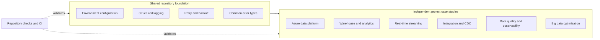

# Data Engineering Portfolio

A practical, evidence driven portfolio focused on modern data engineering: cloud data platforms, batch and streaming pipelines, data integration, warehouse modelling, data quality, and distributed processing.

The repository is designed around realistic business case studies and reproducible engineering work. Project implementations are added and verified incrementally; planned work is clearly labelled rather than presented as completed production experience.

## Portfolio status

**Current release: Repository foundation (Phase 1).** The repository structure, shared development utilities, engineering standards, project specifications, and baseline checks are in place. The six project directories contain project specifications and supporting documentation; their end-to-end implementations have not yet been completed.

| Area | Current status |
|---|---|
| Repository structure and documentation | Implemented |
| Shared Python utilities | Implemented and unit-tested |
| Local development and CI configuration | Configured; CI has not yet been run on GitHub |
| Docker Compose environment | Configured; local container execution remains to be verified |
| Six engineering case studies | Specified; implementation in progress |

See the [Phase 1 verification record](docs/project-documentation/phase-1-verification.md) and [skills heatmap](skills-heatmap.md) for evidence and verification boundaries.

## Focus areas

- Python and SQL engineering
- ETL/ELT and incremental data ingestion
- Azure-oriented data platforms and lakehouse architecture
- Data warehousing and analytics engineering
- Batch and real-time data processing
- Data integration and Change Data Capture (CDC)
- Data quality, testing, and observability
- Distributed processing and performance optimisation
- Reproducible development, Docker, and CI/CD

The focus areas describe the portfolio's intended scope. Individual technologies are marked in the skills heatmap according to their actual implementation and verification status.

## Project portfolio

| # | Project | Business scenario | Main technologies | Status |
|---|---|---|---|---|
| 01 | [Azure end-to-end data platform](01-azure-end-to-end-data-platform/) | E-commerce data platform | Python, SQL, Azure Data Factory, ADLS Gen2, Databricks, PySpark, Delta Lake, Terraform | Specified |
| 02 | [Data warehouse and analytics engineering](02-data-warehouse-and-analytics-engineering/) | SaaS analytics and consistent business metrics | PostgreSQL, SQL, dbt, dimensional modelling | Specified |
| 03 | [Real-time streaming platform](03-real-time-streaming-platform/) | Delivery marketplace event processing | Kafka, Spark Structured Streaming, Python | Specified |
| 04 | [Data integration and CDC](04-data-integration-and-cdc/) | Telecommunications data synchronization | Python, REST APIs, Debezium, Kafka, PostgreSQL | Specified |
| 05 | [Data quality and observability](05-data-quality-and-observability/) | Financial services data reliability | Python, Great Expectations, Airflow, PostgreSQL | Specified |
| 06 | [Big data processing and optimisation](06-big-data-processing-and-optimization/) | High-volume digital platform analytics | Spark, PySpark, Parquet, Delta Lake | Specified |

Each project has a written scope and acceptance criteria in [`docs/project-documentation/`](docs/project-documentation/). This repository intentionally uses one central README; project-specific details are maintained in the specification documents.

## Repository architecture



The shared library contains reusable repository-level helpers. Each project owns its domain logic, dependencies, tests, and execution instructions. See [architecture standards](docs/architecture/standards.md) and the [portfolio architecture source](docs/architecture/portfolio-overview.mmd).

## Engineering principles

1. **Evidence over claims:** only measured or tested capabilities are described as completed.
2. **Reproducibility:** projects include deterministic synthetic data or documented sample inputs and repeatable setup instructions.
3. **Idempotency and incremental processing:** pipelines are designed to safely handle retries and repeated execution.
4. **Observability:** meaningful logs, row counts, failure details, and execution duration are first-class concerns.
5. **Data quality:** invalid records are detected and reported, not silently discarded.
6. **Security:** credentials are supplied through environment variables or secret stores; secrets are never committed.
7. **Practical cost control:** local execution is preferred where possible; cloud-only requirements and potential costs are disclosed.
8. **Maintainability:** modular code, tests, documented decisions, and consistent conventions are preferred over unnecessary complexity.

## Getting started

### Requirements

- Python 3.11 or newer
- GNU Make (optional, for convenience commands)
- Docker Engine and Docker Compose plugin (only for container-based components)

### Set up the development environment

```bash
python3 -m venv .venv
source .venv/bin/activate
python -m pip install --upgrade pip
python -m pip install -r requirements-dev.txt
```

### Run repository checks

```bash
make check
```

The checks include Ruff linting and formatting, repository unit tests, relative Markdown link validation, and a lightweight secret scan.

### Run the shared unit tests without development dependencies

```bash
python -m unittest discover -s tests -t . -v
```

### Start the optional shared PostgreSQL service

```bash
cp .env.example .env
# Change POSTGRES_PASSWORD in .env to a strong local-only password.
make up
```

Stop it with `make down`. The root Compose file is a convenience development database; individual projects may define their own isolated services.

## Documentation

- [Engineering standards](docs/architecture/standards.md)
- [Portfolio architecture](docs/architecture/portfolio-overview.mmd)
- [Engineering decisions](docs/engineering-decisions/)
- [Project specifications](docs/project-documentation/)
- [Benchmarking methodology](docs/project-documentation/benchmarking-methodology.md)
- [Phase 1 verification record](docs/project-documentation/phase-1-verification.md)
- [Skills heatmap](skills-heatmap.md)
- [Contribution and quality rules](CONTRIBUTING.md)

## Evidence and results policy

Business scenarios may be synthetic, but implementations, tests, and benchmark measurements must be real and reproducible. Synthetic data, local simulations, estimates, and actual cloud deployments are labelled distinctly. No production deployment, customer result, performance improvement, or business saving is claimed without supporting evidence.

## License

This repository is released under the MIT License. See [LICENSE](LICENSE).
